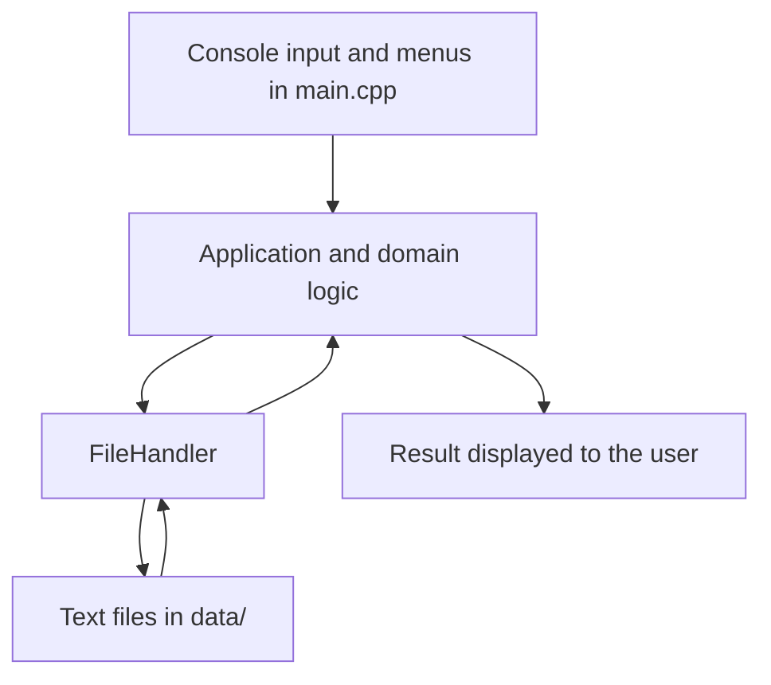
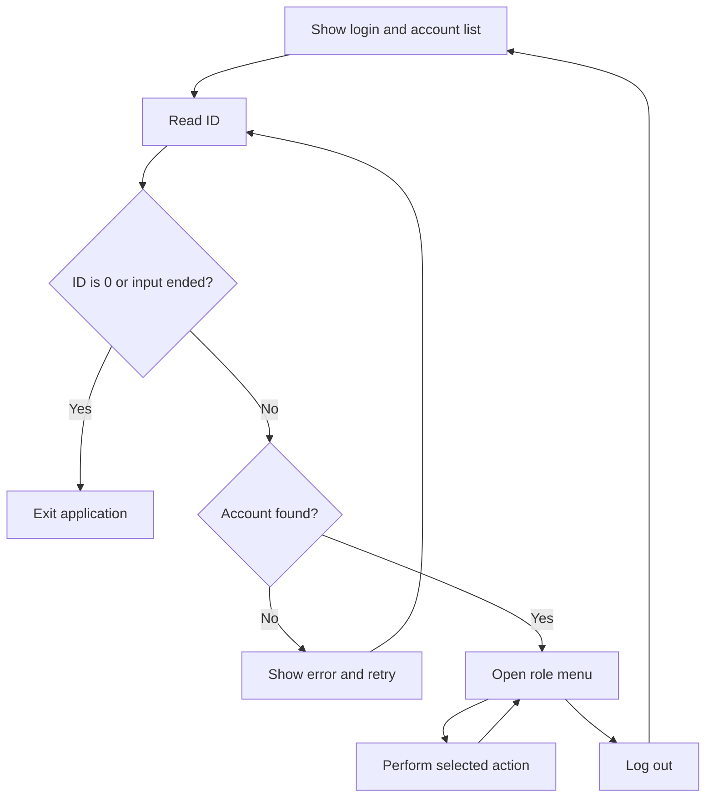
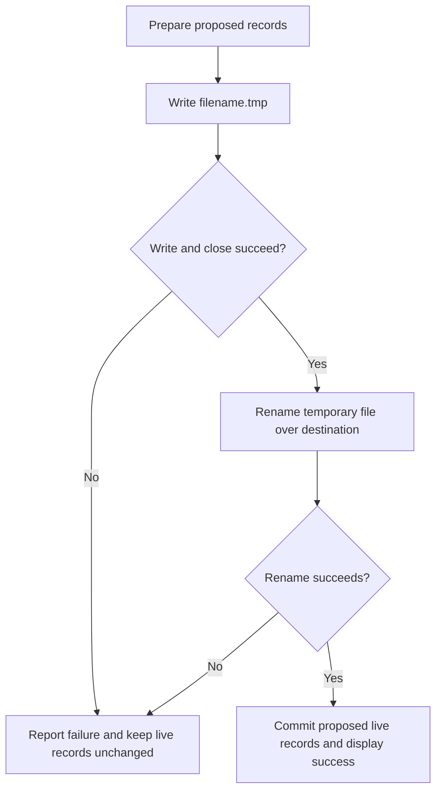

# Program Workflow Guide

This guide explains how the Campus Room Reservation System currently works, from starting the application to saving changes. Read it alongside [main.cpp](../src/main.cpp), which coordinates the console workflow.

## 1. What the application does

The application helps university users find rooms, make bookings, and cancel them. It supports three account types: Student, Staff, and Admin. Admins can also manage user accounts and permanently delete reservations.

Start the program from the project root:

```sh
make run
```

The working directory matters because the program uses relative paths such as `data/users.txt`.

## 2. How the parts work together

| Part | Purpose | Example |
| --- | --- | --- |
| `main.cpp` | Reads input, chooses menu actions, validates console requests, and coordinates the other classes. | Rejects a student attempting to cancel another user's booking. |
| `UserManagementSystem` | Owns loaded users and supports account lookup and role checks. | Finds the account for `S001`. |
| `User` and its subclasses | Represent account details. | Student adds a major; Staff adds a department; Admin adds an office. |
| `Room` | Holds room details and checks attendee limits. | Determines whether a room's maximum capacity supports five people. |
| `Reservation` | Represents one booking and its status, owner, room, and time interval. | Checks whether two booking intervals overlap. |
| `ReservationManagementSystem` | Owns reservation records, maintains indexes, generates IDs, and coordinates reservation changes and persistence. | Creates `RES_1` and requests that it be saved. |
| `FileHandler` | Converts objects to/from text records and performs file I/O. | Writes reservation records to a temporary file, then renames it. |

The application has three main layers:



`FileHandler` handles both loading and saving. It does not decide who may cancel a booking or whether a role menu should be shown. Those decisions belong to the console/application logic and domain classes.

## 3. Startup: loading the saved state

`main()` performs these steps in order:

1. Creates a `UserManagementSystem`.
2. Calls `FileHandler::loadUsers("data/users.txt", ...)`. This creates Student, Staff, and Admin objects. If loading fails or no users are loaded, startup stops.
3. Calls `FileHandler::loadRooms("data/rooms.txt")` to obtain the room list.
4. Creates a `ReservationManagementSystem` and adds each room to it.
5. Calls `ReservationManagementSystem::loadReservations("data/reservations.txt")`.
6. Displays the welcome message and starts the login loop.

Rooms must be registered before reservations are loaded, because each loaded reservation's room ID is checked against the registered rooms.

### What reservation loading does

The reservation system asks `FileHandler` to read the records. If the file does not exist, it attempts to create an empty one. An existing empty file means there are no saved reservations.

The loader reads IDs, owners, rooms, time intervals, and statuses. It rejects invalid field counts, invalid timestamps/statuses, duplicate IDs, and invalid intervals. The reservation system also validates generated ID format and room references. Loading is all-or-nothing: a failed load does not replace the live records.

After a successful load, the reservation system rebuilds:

| Structure | Purpose |
| --- | --- |
| `reservations` | Maps a reservation ID to the reservation object. |
| `roomReservations` | Maps each room ID to its reservation IDs for conflict checks. |
| `nextReservationId` | Continues beyond the largest numeric ID in the loaded records. |
| `reservationFile` | Remembers the filename used for automatic saves. |

If reservation loading fails, `main()` reports the problem and exits before login. This avoids treating unreadable saved data as an empty booking list.

## 4. Login and the session loop

The login screen displays account IDs, names, and roles. The user enters an ID, and `UserManagementSystem::getUser` searches for it.



Login uses an existing ID only; there is no password verification.

| Menu option | Student/Staff | Admin |
| --- | --- | --- |
| `1` | View rooms | View rooms |
| `2` | Search and make a reservation | Search and make a reservation |
| `3` | Cancel own reservation | Cancel any reservation |
| `4` | Unavailable | Manage user accounts |
| `5` | Unavailable | Permanently delete a reservation |
| `0` | Log out | Log out |

The session re-fetches the current account each time it displays the menu. This matters because editing an admin's own account can replace the underlying User object.

## 5. Viewing rooms

Option `1` calls `showRooms`, which displays each room's ID, type, maximum capacity, location, and availability flag.

The availability flag describes whether a room is enabled for booking. It does not by itself indicate that every time slot is free. A time-specific search must also inspect reservations.

The displayed room list is the list loaded at startup. There is currently no menu for adding, editing, or deleting rooms.

## 6. Searching and making a reservation

Option `2` calls the console helper `makeReservation`.

### Input and validation

The user supplies:

- Date: `MM/DD/YYYY`.
- Start and end times: `HH:MM`, using the 24-hour clock.
- Required number of attendees: a positive whole number.

The console parses these values and rejects invalid dates/times, end times not after start times, and invalid attendee counts. Both times use the same date, so overnight bookings cannot be entered through this menu.

### Finding matching rooms

A room is displayed only if all three checks pass:

1. `room.isAvailable()` is true.
2. `room.canAccommodate(attendees)` is true.
3. `reservationSystem.isRoomAvailable(roomID, start, end)` is true.

The attendee check compares against `maxCapacity`, the room's only size property. It accepts positive group sizes up to and including that limit.

The CLI performs this filtering itself. `ReservationManagementSystem::getAvailableRooms` uses the same maximum-capacity, enabled-room, and conflict checks.

### Conflict detection

For each reservation indexed under the selected room, the system skips Cancelled records and calls `Reservation::conflicts` for the rest.

The overlap rule is:

```text
existing.start < requested.end AND requested.start < existing.end
```

| Existing booking | Requested booking | Result |
| --- | --- | --- |
| 10:00–11:00 | 10:30–11:30 | Conflict |
| 10:00–11:00 | 10:00–11:00 | Conflict |
| 10:00–11:00 | 11:00–12:00 | Allowed: adjacent intervals |
| Cancelled 10:00–11:00 | 10:30–11:30 | The cancelled record does not block the request |

### Creating the booking

The user chooses a room ID from the displayed results. Entering `0` at this prompt returns without booking.

The reservation system then:

1. Rechecks room existence and time conflicts, and validates interval order, room availability flag, and a nonempty owner ID.
2. Generates a reservation ID, such as `RES_1`.
3. Creates a Confirmed reservation owned by the logged-in user.
4. Builds a proposed copy of the reservation records containing the new booking.
5. Calls `saveChanges`, which delegates to `FileHandler::saveReservations`.
6. If saving succeeds, replaces the live records, advances the ID counter, updates the room index, and displays success.
7. If saving fails, reports failure and leaves the live records and ID counter unchanged.

## 7. Cancelling a reservation

Option `3` uses the console cancellation helper:

1. Lists non-cancelled reservations permitted for the logged-in user.
2. Students and staff see only records they own; admins see all non-cancelled records.
3. Reads a reservation ID and checks permission again. Entering `0` returns.
4. Calls `ReservationManagementSystem::cancelReservation`.
5. Creates a proposed record set with that reservation's status changed to Cancelled.
6. Saves the proposed records and commits the change only if saving succeeds.

The record stays in the file. Future conflict checks ignore it, so its time slot becomes available again. The cancellation status survives a restart.

## 8. Permanently deleting a reservation

Admin option `5` uses the same console selection helper in deletion mode. It lists all reservations, including cancelled ones.

After validating the selected ID, it calls `ReservationManagementSystem::deleteReservation`, which:

1. Creates a proposed record set without the selected reservation.
2. Saves that proposed set.
3. Removes the ID from the live room index and replaces the live records after a successful save.
4. Prints the deletion result.

| Cancellation | Permanent deletion |
| --- | --- |
| Keeps the record with Cancelled status. | Removes the record from memory and disk. |
| Available to owners and admins through the menu. | Available only to admins through the menu. |
| Releases the booked time slot. | Also releases the booked time slot. |

Deleted IDs can be reused after a restart if they were greater than every remaining ID. The file does not retain a separate historical ID counter.

## 9. Admin account management

Admin option `4` calls `manageUsers`, which checks the admin role again before opening its submenu.

| Submenu option | Workflow |
| --- | --- |
| `1. View users` | Displays identity, email, role, and major/department/office. |
| `2. Add user` | Requires an unused ID, a selected role, and account details; constructs the matching subclass. |
| `3. Edit user` | Requires an existing ID and all replacement details; may change the role, while keeping the same ID. |
| `4. Delete user` | Removes another existing account. |
| `0. Back` | Returns to the admin's main menu. |

### Validation and saving

The console rejects duplicate add IDs, unknown edit/delete IDs, empty or comma-containing fields, and IDs with spaces/tabs. It prevents the logged-in admin from deleting their own account or changing their own role away from Admin.

For a permitted change, it prepares a proposed account map and asks `FileHandler::saveUsers` to save it. Only after a successful save does it replace the live map and release the old account object. If saving fails, the current accounts remain unchanged.

Deleting a user does not remove that user's reservations. Those records remain available for admin cancellation or deletion.

## 10. Text files and the save process

| File | Format | When it changes |
| --- | --- | --- |
| `data/users.txt` | `Role,UserID,Name,Email,ExtraInfo` | After successful admin add/edit/delete. |
| `data/rooms.txt` | `RoomID,Type,MaxCapacity,Location,Available` | Loaded at startup; no current menu edits it. |
| `data/reservations.txt` | `ReservationID,OwnerID,RoomID,StartEpochSeconds,EndEpochSeconds,Status` | After successful booking, cancellation, or permanent deletion. |

Files contain records only, with no header row. Quoted CSV values are not supported. `ExtraInfo` is the major, department, or office. Reservation timestamps are whole seconds since the Unix epoch. The console interprets entered dates using the machine's local time zone.

User and reservation saving follow this pattern:



The application saves immediately after each permitted change; there is no separate Save menu and no requirement to wait until exit. This design is intended for one running application; it does not coordinate concurrent writers or provide a database transaction log.

Creating a standalone reservation system without calling its `loadReservations` method leaves it in in-memory mode. The real application enables persistence during startup. Directly changing a `Reservation` object's status does not itself trigger a file save; persistent changes should go through the reservation system's methods.

## 11. Logout, restart, and cleanup

Logging out leaves loaded rooms, users, and reservations available to the next session. Exiting destroys the in-memory state; saved account and reservation files are loaded again on the next run. `UserManagementSystem` deletes the dynamically allocated User objects it owns during destruction.

There is no final bulk-save step on exit because successful account and reservation mutations have already been saved.

## 12. Example from start to finish

1. Start the application and log in as `S001`.
2. Select `2`, enter a date such as `11/10/2026`, times `10:00` and `11:00`, and `5` attendees.
3. Choose `R101` if it is listed. Note the generated reservation ID.
4. Exit and restart. A search for an overlapping R101 booking is now blocked by the loaded record.
5. Log in as its owner and cancel it using option `3`.
6. Restart again. The record remains Cancelled, and the time slot is available.
7. Log in as `A001` and use option `5` to delete the record permanently.

Use an unoccupied date/time if previous bookings exist.

## 13. Verification and current boundaries

Run the C++ suite from the repository root:

```sh
make all
make test-all
```

The room test checks capacity boundaries and searches automatically. The Makefile automatically discovers the C++ persistence test along with the other `test_*.cpp` files.

[test_reservation_persistence.cpp](../tests/test_reservation_persistence.cpp) checks loading, saved booking fields, overlap rejection, adjacent bookings, ID continuation, persisted cancellation/deletion, failed-save behavior, and invalid loaded records. It uses temporary data rather than the real reservation file.

Other boundaries to remember:

- Room-management menus and reservation modification are not implemented.
- Check-in/check-out status methods exist but are not exposed through menus.
- `Admin::deactivateAccount` is a placeholder.
- Authorization checks are in console helpers; direct reservation API calls do not check the caller's role.
- The application does not validate that a requested booking is in the future or that an email has a valid email syntax.
- Startup room loading assumes valid numeric fields; it is not a general malformed-file recovery system.

For feature lists, build details, and Milestone 3 evidence, see the [README](../README.md).
