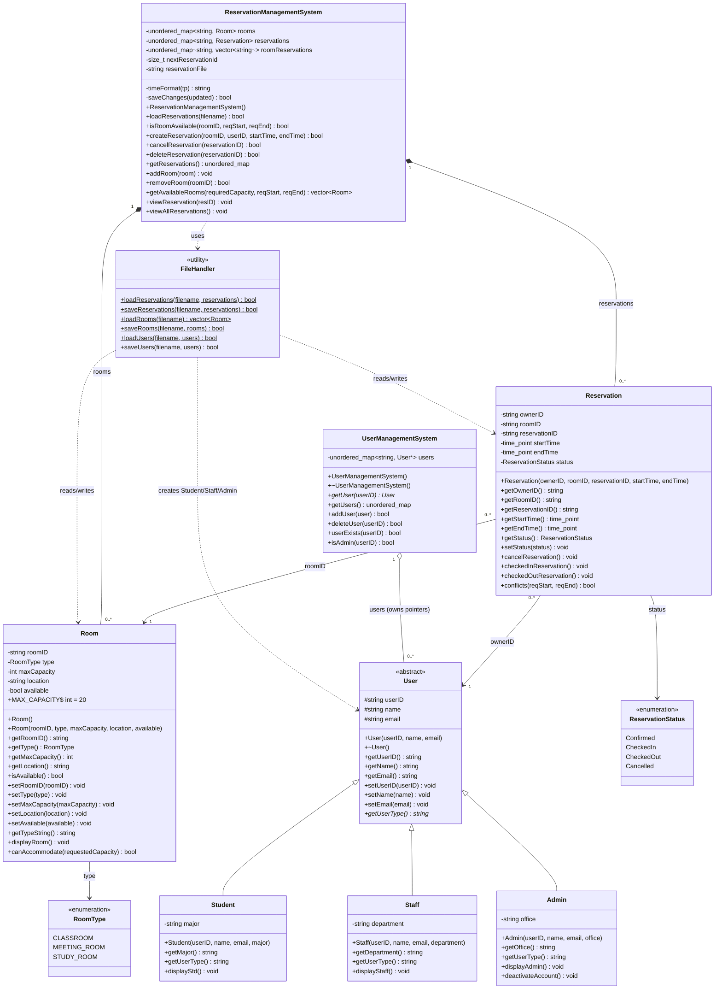

# UML Class Diagram

Generated from the headers in `include/` and the data files in `data/`.

## Data files

| File | Record format | Maps to |
|---|---|---|
| `data/reservations.txt` | `reservationID,ownerID,roomID,startEpoch,endEpoch,status` | `Reservation` |
| `data/rooms.txt` | `roomID,type,maxCapacity,location,available(0/1)` | `Room` |
| `data/users.txt` | `userType,userID,name,email,extraInfo` (major / department / office) | `Student` / `Staff` / `Admin` |
